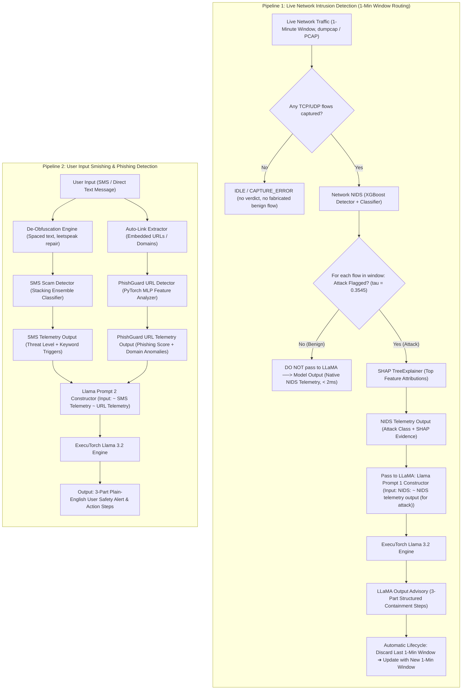
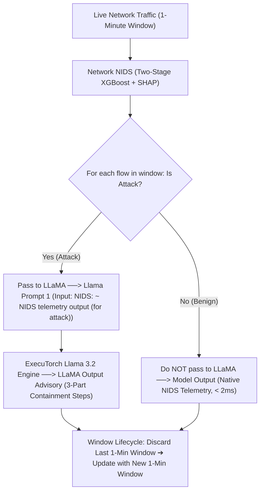
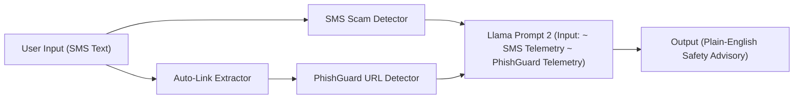

# Bharat AI-SoC: Dual-Pipeline On-Device Edge Threat Detection Architecture

**Problem Statement 3 — On-Device Edge Security**  
Target Hardware: **Linux / Raspberry Pi 5 (Bharat SoC)**

---

## Overview

The **Abhedya SoC** edge security platform integrates multi-tier security models into an on-device threat detection and reasoning architecture. It operates fully offline with sub-millisecond latencies, protecting edge devices against real network intrusions, smishing frauds, and malicious websites.

The system is structured around two dedicated end-to-end processing pipelines orchestrated by [unified_pipeline.py](file:///media/abhilash/SSD2/projects/bharat_ai_soc_challenge/Abhedya_SoC/unified_pipeline.py) and [llama_prompt_builder.py](file:///media/abhilash/SSD2/projects/bharat_ai_soc_challenge/Abhedya_SoC/llama_prompt_builder.py), backed by local **Meta Llama 3.2 1B-Instruct (ExecuTorch 4-bit PTE)** generative AI reasoning.

| Module | Source Repository | Model | Accuracy | Latency |
|--------|------------------|-------|----------|---------|
| **SMS Scam Detector** | `A-spark-of-fire/SMS_Spam_Detector` | Stacking Ensemble (LinearSVC + LogisticRegression + MultinomialNB) | 99.26% | < 1 ms |
| **Phishing URL Detector** | `SwastikSaha/PhishGuard` | PyTorch MLP (375k params, 14 numeric + 1 categorical) | 97.4% | < 2 ms |
| **Network NIDS** | `Abhil4sh777/nids` | Two-Stage 13-Class XGBoost + SHAP TreeExplainer | — | < 2 ms |
| **Edge Reasoning Engine** | Local ExecuTorch 1.5.1 | Meta Llama 3.2 1B-Instruct (4-bit XNNPACK PTE) | Deterministic Grounding | On-Device |

---


---

## Approach 2: Multi-Threaded Dual Engine with Global LLM Mutex

Under **Approach 2**, Pipeline 1 (Live Network NIDS) and Pipeline 2 (Smishing & Phishing detection) execute concurrently in multi-threaded mode on Raspberry Pi 5. Access to the local ExecuTorch Llama 3.2 1B engine is strictly serialized using a global threading mutex (`llm_lock = threading.Lock()`), ensuring zero RAM overload (~1.2 GB limit) and instant sub-2ms edge evaluation for benign events.

### Thread 1: Live Network Monitoring Engine (NIDS)
- **Continuous 60s Tumbling Windows:** Managed by dedicated background thread `nids_thread`.
- **Benign Traffic (`P(Attack) < 0.3545`):** Emits instantaneous sub-2ms verdict to telemetry feed, bypassing Llama engine (0 LLM compute overhead).
- **Attack Traffic (`P(Attack) >= 0.3545`):** Calculates top-5 SHAP feature attributions, acquires `llm_lock`, generates 3-part ExecuTorch Llama Prompt 1 advisory, and releases `llm_lock`.
- **Empty Capture Windows:** Handled gracefully with `IDLE` state logging without packet drops.

### Thread 2: Event-Driven SMS & URL Listener
- **Asynchronous Queue Listener:** Managed by dedicated background thread `sms_thread` ingesting from `_sms_queue`.
- **Processing:** De-obfuscate text -> 25,049-Dim Stacking Ensemble -> PhishGuard PyTorch MLP (auto-extracted links).
- **Clean Content:** Emits instant clean log (<1 ms, 0 LLM compute overhead).
- **Threat Detected:** Acquires `llm_lock`, generates ExecuTorch Llama Prompt 2 safety alert, and releases `llm_lock`.

### Threading Mutex & Resource Management (`llm_lock`)
- Defined globally in `unified_pipeline.py`: `llm_lock = threading.Lock()`.
- Serializes ExecuTorch Llama 3.2 inference calls (`generate_advisory()`) with `with llm_lock:`.
- **Non-blocking sensor evaluation:** Ingestion queues accept network packets and SMS texts without dropping while Llama generates text.
- Memory ceiling is strictly enforced under ~1.2 GB RAM on Raspberry Pi 5.

### Background Engine Lifecycle API Endpoints
- `POST /api/engine/start` — Start concurrent `nids_thread` and `sms_thread`
- `POST /api/engine/stop` — Gracefully stop both threads
- `GET /api/engine/status` — Real-time thread states, queue depth, threats detected, LLM lock state
- `GET /api/engine/events` — Retrieve event stream (up to 500 capped entries)
- `POST /api/engine/submit/sms` — Async SMS submission to Thread 2 queue
- `POST /api/engine/submit/url` — Async URL submission to Thread 2 queue


## Dual Threat Detection Pipelines

The edge platform executes two operational pipelines depending on the incoming data vector:

```
Pipeline 1: Live Network (1-Min Window W) ──> Network NIDS (Two-Stage XGBoost + SHAP)
            ├─ For each flow: if Benign ──> DO NOT pass to LLaMA ──> Model Output (Sub-2ms NIDS verdict)
            └─ For each flow: if Attack ──> Pass to LLaMA ──> Llama Prompt 1 (Input: NIDS: ~ NIDS telemetry output (for attack)) ──> LLaMA Output Advisory
            └─ Tumbling Lifecycle: Automatically updates with new 1-min window & automatically discards last 1-min window

Pipeline 2: User Input ──> SMS Scam Detector ──> Extract URL ──> PhishGuard URL Detector ──> Llama Prompt 2 (Input: ~ SMS Scam Detector telemetry output ~ PhishGuard URL Detector telemetry output) ──> Output Advisory
```



---

### Pipeline 1: Live Network Threat Pipeline

$$\text{Live Network Window } W \text{ (1 min / 60 seconds)} \longrightarrow \forall \text{ flow } f_i \in W:$$
$$\begin{cases}
f_i \text{ is Benign} & \implies \textbf{Do NOT pass to LLaMA} \longrightarrow \textbf{Model Output } (\text{NIDS Classifier Verdict, } < 2\text{ms, } 0 \text{ LLM Compute}) \\
f_i \text{ is Attack} & \implies \textbf{Pass to LLaMA} \longrightarrow \textbf{Llama Prompt 1 } (\text{Input: NIDS: } \sim \text{NIDS telemetry output (for attack)}) \longrightarrow \textbf{LLaMA Output Advisory}
\end{cases}$$



#### Operational Workflow & 1-Minute Window Lifecycle:
1. **Window Size Contract (1 Minute / 60 Seconds):**
   - The standardized network capture and inference window is **1 minute (60 seconds)**.
   - Real network packet capture directly interfaces with host Linux network devices (`dumpcap -i <interface> -a duration:60 -w <tmp.pcap>`) or real PCAP/PCAPNG packet capture replay parsed through native DPkt flow reconstruction into the 121-feature contract.
   - The capture engine forces classic `pcap` output (or uses DPkt's pcapng reader), decodes the capture's actual link type (Ethernet, Linux SLL/SLL2, raw IP, BSD loopback), and keeps only **TCP/UDP** flows because the fitted NIDS contract does not support ICMP or other IP protocols.
   - If the capture window contains **no packets**, the pipeline returns `status: "IDLE"` with `findings: []`. If `dumpcap` is missing, the interface does not exist, or the user lacks capture permissions, it returns `status: "CAPTURE_ERROR"` with the `dumpcap` error. **It never fabricates an `idle-window` benign flow** with a fake 0% attack probability or 0.00 ms latency.
2. **Start Control & Continuous Automated Lifecycle:**
   - **Start Button:** In both web dashboards (Streamlit & Flask) and via CLI (`--continuous`), operators trigger continuous monitoring via the **Start** button.
   - **Automatic Update with New 1-Min Window:** When each 1-minute window capture completes, the NIDS detector, SHAP explainer, per-flow routing engine, and ExecuTorch LLaMA copilot immediately evaluate the traffic, and the dashboard is automatically updated with the newly analyzed window.
   - **Automatic Discard of Last 1-Min Window:** As soon as a new 1-minute window arrives, the prior 1-minute window data, feature matrices, and temporary capture buffers are automatically discarded. This enforces strict edge memory constraints (avoiding unbounded RAM accumulation) while keeping threat intelligence current.
   - **Stop Button:** Ceases subsequent captures, retaining the latest evaluated 1-minute window on screen.
3. **NIDS Two-Stage Evaluation:**
   - **Binary Gate:** Fast XGBoost detector evaluates each flow in the window against calibrated decision threshold (`tau = 0.3545`).
   - **13-Class Classifier:** For flows exceeding threshold, classifies specific attack vector (`DoS_Hulk`, `Port_Scan`, `DDoS_LOIT`, `FTP-Patator`, `DoS_GoldenEye`, `DoS_Slowhttptest`, `SSH-Patator`, `Botnet_ARES`, `DoS_Slowloris`, `Web_Brute_Force`, `Web_XSS`, `Web_SQL_Injection`, `Heartbleed`).
   - **SHAP TreeExplainer:** Computes exact mathematical feature attributions explaining what abnormal flow metrics triggered the alarm (e.g. `fwd_psh_flag_counts`, `fwd_packets_IAT_mean`).
4. **Per-Flow Routing Policy:**
   - **If Benign:** The flow is **not** passed to LLaMA. The pipeline immediately emits native **Model Output** (verdict: `Benign`, confidence, attack probability, decision threshold, and latency $< 2$ms). Zero LLM tokens and zero GPU/NPU cycles are consumed, maximizing edge battery life and throughput.
   - **If Attack:** The flow **is** passed to LLaMA. The structured NIDS attack telemetry payload (attack class, target port, protocol, and SHAP mathematical evidence) is wrapped into `build_llama_prompt_pipeline_1()` with `SYSTEM_PROMPT_PIPELINE_1`, embedding the contract: `Input: NIDS: ~ NIDS telemetry output (for attack)`.
5. **Output Generation:**
   - **Model Output (for Benign):** Native NIDS classification metadata with zero LLM overhead.
   - **LLaMA Output (for Attack):** Local ExecuTorch Llama 3.2 engine generates a targeted 3-part plain-English advisory:
     - ⚠️ **Threat Summary:** Intrusion type, source IP, and target destination port.
     - 🔍 **Technical Reason:** Explains top SHAP attribution drivers in plain language.
     - 🛡️ **Recommended Actions:** 3 concrete containment steps (firewall IP blocking, port isolation, background process inspection).

#### Resolution of the Live Capture `idle-window` Issue:

In earlier iterations, whenever a live network capture window observed 0 packets (common on idle test devices, down interfaces, or quiet networks), the pipeline substituted a synthetic placeholder flow:
```text
Ingested Flow: idle-window
Protocol: TCP
NIDS Verdict: BENIGN (Benign)
Attack Probability: 0.0% (tau: 35.4%)
NIDS Latency: 0.00 ms (Sub-2ms)
```
This behavior had critical flaws:
1. **Misleading Telemetry:** An idle capture with 0 packets was falsely reported as a clean, benign network flow evaluated by the XGBoost NIDS model with 0.00 ms latency and 0.0% attack probability, masking the fact that no packets were evaluated.
2. **Hardcoded Interface Bottleneck:** Static interface lists (e.g. `eth0` on Wi-Fi-only hardware) caused capture commands to exit immediately or capture zero packets, repeatedly producing this synthetic placeholder flow.

**How This Has Been Resolved:**
1. **Strict Empty-Window Contract:** When zero packets/flows are captured, the pipeline returns `status: "IDLE"`, `findings: []`, `total_flows_count: 0`, and `output_type: "no_output"`. It never fabricates an `idle-window` flow, nor does it report fake 0.0% probabilities or 0.00 ms latencies.
2. **Explicit Capture Error Reporting:** If `dumpcap` fails (permission denied, missing tool, invalid interface), `status: "CAPTURE_ERROR"` is returned with the exact error details from stderr.
3. **Dynamic Host Interface Discovery:** `get_available_interfaces()` dynamically queries `dumpcap -D` and host network devices, prioritizing active network interfaces (`wlo1`, `any`, `eno1`, `lo`) over non-existent interfaces.
4. **Interactive Traffic Probe Generator (`--probe` / UI checkbox):** To facilitate verification on quiet test devices, users can enable probe generation (`probe=True` / `--probe` flag / checkbox in Streamlit and Flask dashboards). During the capture window, a lightweight HTTP/DNS request is dispatched in the background, guaranteeing that real line-rate packets flow across the interface and are evaluated by the NIDS engine.
5. **Dashboard Diagnostics:** Both the Streamlit and Flask UIs now render dedicated status banners (Amber for `IDLE`, Red for `CAPTURE_ERROR`) with diagnostic guidance and empty dashes (`—`) for flow metrics, rather than showing fake benign verdicts.

#### Empty-Window & Capture-Failure Contract:

A live capture window is not guaranteed to contain traffic. The pipeline distinguishes three outcomes instead of always emitting a benign verdict:

| Outcome | `status` | `findings` | Dashboard behavior |
|---------|----------|------------|--------------------|
| Real flow(s) evaluated | `CLEAN` / `ALERT` | One object per TCP/UDP flow | Flow metrics, SHAP, and routing are shown normally |
| Capture succeeded, zero packets/flows | `IDLE` | `[]` | Amber **IDLE — no flows captured** card with interface, duration, and troubleshooting; no probability/latency is shown |
| `dumpcap` missing, invalid interface, or permission failure | `CAPTURE_ERROR` | `[]` + `capture_error` | Red **CAPTURE FAILED** card with the actual `dumpcap` error and remediation steps |

#### Prompt 1 Telemetry Input Schema:
```json
{
  "status": "ALERT",
  "active_threats_count": 1,
  "findings": [
    {
      "module": "Network_NIDS",
      "flow_id": "parity-000",
      "src_ip": "10.0.0.1",
      "dst_ip": "10.0.0.2",
      "dst_port": 41743,
      "protocol": "TCP",
      "is_attack": true,
      "attack_type": "SSH-Patator",
      "confidence": 0.4625,
      "shap_evidence": [
        {"feature": "fwd_psh_flag_counts", "value": 497.42, "shap_value": 1.3097},
        {"feature": "fwd_packets_IAT_mean", "value": 232.37, "shap_value": -0.9651}
      ]
    }
  ]
}
```

---

### Pipeline 2: User Input Smishing & Phishing Pipeline

$$\text{User Input} \longrightarrow \text{SMS Scam Detector} \longrightarrow \text{Extract URL} \longrightarrow \text{PhishGuard URL Detector} \longrightarrow \text{Llama Prompt 2 } (\text{Input: } \sim \text{SMS Telemetry } \sim \text{PhishGuard Telemetry}) \longrightarrow \text{Output}$$



#### Operational Workflow:
1. **User Input Ingestion:** User receives an SMS or inputs suspicious message text.
2. **SMS Scam Analysis:**
   - Text is passed through the de-obfuscation engine (normalizing spaced text `k y c` → `kyc`, leetspeak `b@nk` → `bank`, dot hiding `dr . ugs` → `drugs`).
   - Analyzed by the 25,049-dimension Stacking Ensemble classifier (`tau = 0.390`), outputting threat score, risk level, and extracted trigger words.
3. **Auto-Link Extraction:** The regex engine automatically extracts any embedded URLs, IP hostnames, or shortlinks without manual intervention.
4. **PhishGuard URL Verification:** Extracted URLs are routed directly to the PyTorch MLP (375k parameters) to detect lexical anomalies, brand impersonation, entropy spikes, and high-risk TLDs (`.xyz`, `.top`, etc.).
5. **Llama Prompt 2:** Both telemetry results (SMS threat score + PhishGuard URL confidence and domain anomalies) are merged into `build_llama_prompt_pipeline_2()` with `SYSTEM_PROMPT_PIPELINE_2`, embedding the contract: `Input: ~ SMS Scam Detector telemetry output ~ PhishGuard URL Detector telemetry output`.
6. **Output Generation:** Local Llama 3.2 synthesizes a user-friendly alert:
   - ⚠️ **Threat Summary:** Identifies the deceptive impersonation scheme and fraudulent website.
   - 🔍 **Technical Reason:** Explains the detected urgency triggers, obfuscation tricks, and domain anomaly flags.
   - 🛡️ **Recommended Actions:** 3 protective safety steps (do not click links, delete SMS, verify only via official bank portal).

#### Prompt 2 Telemetry Input Schema:
```json
{
  "status": "ALERT",
  "active_threats_count": 2,
  "findings": [
    {
      "module": "SMS_Spam_Detector",
      "raw_text": "URGENT: Your SBI account is locked. Update KYC immediately at http://sbi-kyc.top",
      "is_threat": true,
      "threat_score": 0.9978,
      "threat_level": "HIGH",
      "detected_triggers": ["kyc", "bank", "account", "urgent", "update"]
    },
    {
      "module": "PhishGuard_URL_Detector",
      "url": "http://sbi-kyc.top",
      "is_phishing": true,
      "confidence_score": 0.9998,
      "domain_anomalies": [
        "High-risk top-level domain (.top) frequently abused for phishing.",
        "Unencrypted connection (HTTP instead of HTTPS)."
      ]
    }
  ]
}
```

---

## Repository Structure

```
Abhedya_SoC/
├── .gitmodules                  # Git submodule tracking for 3 component repos
├── modules/                     # Sub-system security repositories
│   ├── __init__.py              # Python module wiring & path configuration
│   ├── sms_spam_detector/       # Submodule: A-spark-of-fire/SMS_Spam_Detector
│   │   ├── sms_classifier_model.pkl
│   │   ├── tfidf_word_vectorizer.pkl
│   │   ├── tfidf_char_vectorizer.pkl
│   │   └── sms_decision_threshold.pkl
│   ├── phishguard/              # Submodule: SwastikSaha/PhishGuard
│   │   ├── phishguard_artifacts/
│   │   │   ├── phishguard_mlp.pth
│   │   │   ├── preprocessor.joblib
│   │   │   └── model_config.json
│   │   ├── live_classifier.py
│   │   └── mlp_model.py
│   └── nids/                    # Submodule: Abhil4sh777/nids
│       ├── models/
│       │   ├── detector.joblib  # Binary XGBoost detector (tau=0.3545)
│       │   └── classifier.joblib# 13-class XGBoost classifier
│       ├── features/contract.py
│       ├── explain/shap_explainer.py
│       └── pipeline.py
├── scripts/
│   ├── download_llama.sh        # Bash model asset downloader from Hugging Face
│   └── download_llama.py        # Cross-platform Python downloader for PTE & tokenizer
├── models/
│   └── llama/                   # Local ExecuTorch Llama 3.2 1B-Instruct model assets
├── llama_prompt_builder.py      # Prompt constructors: build_llama_prompt_1 & build_llama_prompt_2
├── executorch_runner.py         # ExecuTorch 1.5.1 C++ runner wrapper & grounded fallback
├── unified_pipeline.py          # Unified pipeline engine: run_pipeline_1 & run_pipeline_2
├── app_dashboard.py             # Streamlit Edge UI with live telemetry & AI reasoning card
├── app_flask.py                 # Lightweight REST API server
├── templates/
│   └── index.html               # Cyber-styled HTML5/CSS3/JS edge dashboard
├── tests/
│   └── test_llama_stitch.py     # Comprehensive test suite (9 tests)
├── requirements.txt             # Merged dependencies across all modules
└── data/
    ├── sample_flows.csv         # Reference NIDS flow dataset
    └── sample_traffic.pcap      # Real PCAP network capture for line-rate packet replay
```

---

## Quick Start

### 1. Clone & Initialize Submodules

```bash
# Clone repository
git clone --recursive <repo-url>
cd Abhedya_SoC

# Initialize and update submodules
git submodule update --init --recursive
```

### 2. Install Dependencies

```bash
# System packages (Linux / Raspberry Pi 5)
# NOTE: the Debian/Ubuntu package that provides `dumpcap` is wireshark-common.
sudo apt update && sudo apt install -y git python3-pip wireshark-common

# Allow non-root live capture (choose "Yes" when prompted), then re-login:
sudo dpkg-reconfigure wireshark-common
sudo usermod -aG wireshark $USER

# Python packages
pip install -r requirements.txt

# For Raspberry Pi 5 (ARM64), install CPU-optimized PyTorch:
pip install torch --index-url https://download.pytorch.org/whl/cpu
```

### 3. Run Pipeline 1 via CLI (Live Network Capture / PCAP Replay)

```bash
# Option A: Run Pipeline 1 on a real PCAP packet replay
python unified_pipeline.py --pipeline-1 data/sample_traffic.pcap

# Option B: Run Pipeline 1 on live network interface capture (1-minute window default)
python unified_pipeline.py --interface lo --duration 60

# Option C: Run Pipeline 1 continuous monitoring (tumbling 1-min windows)
# Automatically updates with new 1-min window and automatically discards last 1-min window:
python unified_pipeline.py --interface lo --continuous

# Shorthand notation:
python unified_pipeline.py --p1 data/sample_traffic.pcap
```

### 4. Run Pipeline 2 via CLI (User Input Smishing + Phishing Detection)

```bash
# Run Pipeline 2 on incoming text
python unified_pipeline.py --pipeline-2 "URGENT: Your SBI account is locked. Update KYC: http://sbi-verification.xyz"

# Or using the shorthand:
python unified_pipeline.py --p2 "URGENT: Your SBI account is locked. Update KYC: http://sbi-verification.xyz"
```

### 5. Run Automated CLI Demonstration

```bash
python unified_pipeline.py --demo
```

### 6. Launch Web Dashboards

```bash
# Streamlit Web UI (Port 8501)
streamlit run app_dashboard.py --server.port 8501 --server.address 0.0.0.0

# Flask REST API + Cyber-Defense Web Dashboard (Port 5000)
python app_flask.py
```

---

## Interactive Dashboard & Web Interfaces

The Abhedya SoC security platform provides two complementary web interfaces (Streamlit in [app_dashboard.py](file:///media/abhilash/SSD2/projects/bharat_ai_soc_challenge/Abhedya_SoC/app_dashboard.py) and Flask/Tailwind in [templates/index.html](file:///media/abhilash/SSD2/projects/bharat_ai_soc_challenge/Abhedya_SoC/templates/index.html)), each structured around dedicated operational workflows for **Pipeline 1** and **Pipeline 2**:

### 1. Tab 1: Pipeline 1 Interface (Live Network ➔ NIDS ➔ Llama Prompt 1 ➔ Output)
- **Window Size Contract:** Standardized **1-minute (60 seconds)** sliding/tumbling capture window.
- **Start / Stop Monitoring Controls:**
  - **Start Button (`▶️ Start 1-Min Window Monitoring`):** Initiates continuous automated 1-minute window ingestion.
  - **Automatic Window Update:** When the 1-minute capture window concludes, the dashboard automatically updates with the newly evaluated network flow telemetry, SHAP attributions, and LLaMA advisory (for attack) or Model Output (for benign).
  - **Automatic Window Discard:** The prior 1-minute window's data and state are automatically discarded upon the arrival of each new window to preserve edge memory budgets and present continuous, fresh real-time situational awareness.
  - **Stop Button (`⏹️ Stop Monitoring`):** Stops the continuous capture cycle and retains the current evaluated 1-minute window on screen.
  - **Single Execution (`⚡ Execute Single 1-Min Window`):** Runs an isolated 1-minute window trace on-demand.
- **Visual Pipeline Breadcrumbs:** Real-time step progress (`Live Network Ingestion` ➔ `NIDS Two-Stage Gate` ➔ `SHAP Attribution Engine` ➔ `Llama Prompt 1 Constructor` ➔ `ExecuTorch Security Advisory`).
- **Real Network Ingestion Controls:**
  - *Live Interface Capture (`dumpcap`):* Real line-rate packet capture on host network interfaces (`eth0`, `wlan0`, `lo`, `any`) parsed dynamically via native DPkt flow reconstruction into the 121-feature contract. The sidebar shows whether `dumpcap` is available.
  - *Idle / failure handling:* An empty capture window renders an explicit **IDLE — no flows captured** warning (with the capture interface and window duration). A missing `dumpcap`, invalid interface, or permission failure renders a **CAPTURE FAILED** card containing the actual `dumpcap` error and troubleshooting steps. No benign verdict, 0% attack probability, or 0.00 ms latency is invented for an empty window.
  - *Real PCAP / PCAPNG Replay:* Drag-and-drop or ingest real `.pcap` / `.pcapng` packet capture files (`data/sample_traffic.pcap`) evaluated through native DPkt flow assembly.
- **Explainability Visualization:**
  - NIDS Verdict card with confidence score and calibrated threshold ($\tau = 0.3545$).
  - Top-5 SHAP feature contributions displayed as both a tabular breakdown and an interactive Altair horizontal bar chart (red for attack attributions, blue for benign attributions).
- **Llama Prompt 1 Card:** Displays the exact zero-shot prompt constructed with the contract `Input: NIDS: ~ NIDS telemetry output (for attack)`.
- **ExecuTorch Reasoning Advisory Card:** High-contrast cyan card displaying the 3-part plain-English advisory (Threat Summary, Technical Reason explaining flow anomalies & SHAP metrics, and exactly 3 Recommended Actions).
- **RFC 8259 Telemetry JSON:** Downstream-ready standardized schema.

### 2. Tab 2: Pipeline 2 Interface (User Input ➔ SMS ➔ Extract URL ➔ PhishGuard ➔ Llama Prompt 2 ➔ Output)
- **Visual Pipeline Breadcrumbs:** Real-time step progress (`User Input Text` ➔ `Text De-Obfuscation` ➔ `SMS Scam Ensemble` ➔ `Auto-Link Extractor` ➔ `PhishGuard URL MLP` ➔ `Llama Prompt 2 Constructor` ➔ `ExecuTorch Safety Advisory`).
- **Interactive Preset Scenarios:**
  - *Bank KYC Smish:* Urgency text with high-risk deceptive phishing link (`http://sbi-banking-verify-update.xyz/login.php?user=victim`).
  - *Lottery Prize Scam:* Cash reward social engineering with URL shortlink (`https://bit.ly/claim-prize-now`).
  - *Obfuscated Leetspeak Message:* Hiding words via spaced letters (`b l o c k e d`), symbols (`b@nk`, `k-y-c`), and dots (`dr . ugs`).
  - *Clean Legitimate Message:* Baseline daily communication.
- **De-Obfuscation Comparison:** Side-by-side display of Raw User Input vs De-obfuscated Normalized Text.
- **Model Telemetry Cards:**
  - *SMS Scam Detector:* Threat probability %, severity badge (`HIGH`, `MEDIUM`, `LOW`), decision threshold ($\tau = 0.390$), and extracted urgency triggers (`kyc`, `bank`, `urgent`, etc.).
  - *Auto-Link Extractor:* Extracted embedded URLs and domains highlighted and forwarded to PhishGuard automatically.
  - *PhishGuard URL Detector:* Phishing confidence %, benign probability %, and list of flagged domain anomalies (suspicious TLDs, typosquatting, HTTP unencrypted).
- **Llama Prompt 2 Card:** Displays the exact zero-shot prompt constructed with the contract `Input: ~ SMS Scam Detector telemetry output ~ PhishGuard URL Detector telemetry output`.
- **ExecuTorch Reasoning Advisory Card:** High-contrast cyan card displaying the 3-part plain-English safety alert (Threat Summary, Technical Reason explaining obfuscation & suspicious domains, and exactly 3 protective steps).
- **RFC 8259 Telemetry JSON:** Standardized schema payload.

### 3. Tab 3: Edge SoC Architecture
Edge hardware deployment specifications (Broadcom BCM2712 / Bharat SoC Quad-core Cortex-A76 @ 2.4GHz), memory budgets, and inference latencies.

---

## Python API Usage

```python
from unified_pipeline import UnifiedThreatPipeline

# Initialize the unified pipeline (loads all models on device)
pipeline = UnifiedThreatPipeline(enable_llm_reasoning=True)

# ---------------------------------------------------------------------------------
# PIPELINE 1: Live Network -> NIDS -> Per-Flow Routing -> Output
# Contract: for each flow in window:
#   ~ if benign: do not pass to llama -> model output
#   ~ if attack: pass to llama -> llama output
# ---------------------------------------------------------------------------------
# 1a. Benign Network Traffic (PCAP packet stream or clean live capture)
res_benign = pipeline.run_pipeline_1("data/sample_traffic.pcap")
print("Status:", res_benign["status"])               # 'CLEAN'
print("Passed to LLaMA:", res_benign["passed_to_llama"]) # False
print("Output Type:", res_benign["output_type"])         # 'model_output'
print("Model Output:", res_benign["output"])            # Native NIDS classification (0 LLM overhead)

# 1b. Network Intrusion Traffic (Attack flow / live attack packet stream)
# (e.g. DoS_Slowhttptest attack flow)
import pandas as pd
df_flows = pd.read_csv("data/sample_flows.csv")
res_attack = pipeline.run_pipeline_1(df_flows.iloc[3:4])
print("Status:", res_attack["status"])               # 'ALERT'
print("Passed to LLaMA:", res_attack["passed_to_llama"]) # True
print("Output Type:", res_attack["output_type"])         # 'llama_output'
print("Prompt 1:", res_attack["llama_prompt"])          # Llama Prompt 1 with attack telemetry
print("Advisory 1:", res_attack["llama_advisory"])      # 3-part plain-English advisory & containment

# 1c. Real live Linux interface capture (1-minute window default):
# - With active network traffic or built-in probe (ensures live flows):
res_live = pipeline.run_pipeline_1(live_interface="any", duration_seconds=60, probe=True)
print("Live status:", res_live["status"])              # 'CLEAN' or 'ALERT'
print("Flows captured:", res_live["total_flows_count"]) # e.g. 2 or 5 flows
print("Window size:", res_live["window_size_label"])   # '1 min'

# 1d. Continuous Tumbling Window Stream (Auto-update with new 1-min window & auto-discard last window):
for window in pipeline.stream_pipeline_1(live_interface="any", duration_seconds=60, probe=True, max_windows=3):
    print(f"Window #{window['window_number']} ({window['timestamp']}): Status={window['status']} | Discarded prior window")

# 1e. Empty or quiet capture window is explicitly IDLE (never a fake benign flow):
res_idle = pipeline.run_pipeline_1(live_interface="lo", duration_seconds=1, probe=False)
if res_idle["status"] in {"IDLE", "CAPTURE_ERROR"}:
    print(res_idle["status"], res_idle["message"])
    print("findings:", res_idle["findings"])          # [] — no invented verdict
    print("output_type:", res_idle["output_type"])    # 'no_output'

# ---------------------------------------------------------------------------------
# PIPELINE 2: User Input -> SMS -> Extract URL -> PhishGuard -> Llama Prompt 2 -> Output
# ---------------------------------------------------------------------------------
user_text = "URGENT: Your KYC has expired. Update now at http://sbi-kyc.top"
res_p2 = pipeline.run_pipeline_2(user_text)
print("Status:", res_p2["status"])
print("Prompt 2:", res_p2["llama_prompt"])
print("Advisory 2:", res_p2["llama_advisory"])
```

---

## Llama 3.2 Prompt Construction Engine

Both pipelines construct zero-shot chat prompts formatted according to Meta's strict Llama 3.2 token contract (`<|begin_of_text|>`, `<|start_header_id|>`, `<|eot_id|>`).

Implemented in [llama_prompt_builder.py](file:///media/abhilash/SSD2/projects/bharat_ai_soc_challenge/Abhedya_SoC/llama_prompt_builder.py):

### Prompt 1: Network Intrusion Advisory Constructor (Pipeline 1)

```text
<|begin_of_text|><|start_header_id|>system<|end_header_id|>

You are the on-device network security assistant for Abhedya SoC.
Your job is to translate technical live network intrusion detection telemetry from the on-device NIDS (13-class XGBoost classifier and SHAP mathematical explainability engine) into a simple, plain-English advisory for security operators and non-technical users.

STRICT RULES:
1. Ground your answer strictly in the provided NIDS telemetry. Never invent attacks or IP addresses not present in the payload.
2. Output a 3-part structured alert:
   - ⚠️ **Threat Summary:** What network intrusion was detected in plain English.
   - 🔍 **Technical Reason:** Why it is dangerous (explain flow anomalies, target ports/protocols, and top SHAP feature attributions simply).
   - 🛡️ **Recommended Actions:** Exactly 3 clear network containment/mitigation steps the operator should take.
<|eot_id|>
<|start_header_id|>user<|end_header_id|>

Review the following live network intrusion detection (NIDS) telemetry output (for attack) and generate the plain-language safety alert:

Input: NIDS: ~ NIDS telemetry output (for attack)
```json
{NIDS_TELEMETRY_JSON}
```
<|eot_id|><|start_header_id|>assistant<|end_header_id|>
```

### Prompt 2: User Smishing & Phishing Advisory Constructor (Pipeline 2)

```text
<|begin_of_text|><|start_header_id|>system<|end_header_id|>

You are the on-device communication & web security assistant for Abhedya SoC.
Your job is to translate technical threat telemetry from user input analysis—correlating the on-device SMS Scam Detector and the PhishGuard URL Detector—into a simple, plain-English advisory for end users.

STRICT RULES:
1. Ground your answer strictly in the provided SMS and PhishGuard URL telemetry. Never invent threats or links not present in the payload.
2. Output a 3-part structured alert:
   - ⚠️ **Threat Summary:** What deceptive scam or phishing attempt was detected in plain English.
   - 🔍 **Technical Reason:** Why it is dangerous (explain text obfuscation, urgency triggers, high-risk TLDs, and domain anomalies simply).
   - 🛡️ **Recommended Actions:** Exactly 3 clear safety steps the user should take.
<|eot_id|>
<|start_header_id|>user<|end_header_id|>

Review the following user input threat telemetry (~ SMS Scam Detector telemetry output ~ PhishGuard URL Detector telemetry output) and generate the plain-language safety alert:

Input: ~ SMS Scam Detector telemetry output ~ PhishGuard URL Detector telemetry output
```json
{USER_INPUT_TELEMETRY_JSON}
```
<|eot_id|><|start_header_id|>assistant<|end_header_id|>
```

---

## Module Technical Specifications

### Module 1: SMS Scam Detector
- **Model Architecture:** Stacking Ensemble consisting of Calibrated LinearSVC, Logistic Regression, and Multinomial Naive Bayes.
- **De-Obfuscation Engine:**
  - Spaced letter reconstruction: `c l i c k` → `click`, `k y c` → `kyc`
  - Dot obfuscation removal: `dr . ugs` → `drugs`, `gen . eric` → `generic`
  - Leetspeak translation: `b@nk` → `bank`, `k-y-c` → `kyc`, `up1` → `upi`, `fr33` → `free`
- **Feature Vector (25,049 dimensions):**
  - 10,000 Word TF-IDF n-grams
  - 15,000 Character TF-IDF n-grams
  - 49 Structural/Domain indicators (urgency symbols, uppercase ratio, currency markers, 39 domain triggers)
- **Decision Threshold:** $\tau = 0.390$

### Module 2: PhishGuard URL Detector
- **Model Architecture:** PyTorch Multilayer Perceptron (MLP) with 375,000 parameters.
- **Feature Extraction:**
  - 14 numeric features: URL length, Shannon entropy, slash counts, query length, domain entropy, subdomain depth, digit count, hyphen count, HTTPS flag, raw IP flag, `@` symbol presence.
  - 1 categorical feature (TLD) mapped via OneHotEncoder.
- **Anomaly Detection:** Flags suspicious TLDs (`.xyz`, `.top`, `.tk`), credential-harvesting keywords (`login`, `verify`, `kyc`, `banking`), and brand typosquatting.

### Module 3: Network NIDS
- **Input Workflows:**
  - Real Live Interface Capture: Line-rate packet capture via Linux `dumpcap` on interfaces (`eth0`, `wlan0`, `lo`, `any`) parsed into the 121 BCCC feature contract exclusively via NTLFlowLyzer. The extractor reads the capture, filters to TCP/UDP flows, and reports an explicit `IDLE` or `CAPTURE_ERROR` status when no flows or permissions are available.
  - Real PCAP / PCAPNG Replay: Real packet capture file ingestion parsed through mandatory NTLFlowLyzer flow feature extraction (classic pcap and pcapng are both supported). Partial 40-column fallback parsers (DPkt) are deprecated.
- **Two-Stage Architecture:**
  - Binary XGBoost detector ($\tau = 0.3545$) for line-rate packet flow filtering.
  - 13-class XGBoost classifier identifies DoS/DDoS, brute force, and exploit variants.
  - TreeExplainer SHAP attribution highlights the top-5 feature drivers responsible for the prediction.
- **Empty-Window & Capture Contract:** `status: "IDLE"`, `total_flows_count: 0`, `findings: []`, `output_type: "no_output"`. Capture failures return `status: "CAPTURE_ERROR"` and an explicit `capture_error: "dumpcap unavailable or insufficient permissions (run sudo usermod -aG wireshark $USER)"`. No synthetic or fallback flow rows (`sample_flows.csv`) are ever emitted.

---

## Flask REST API Reference

| Endpoint | Method | Pipeline Mapping | Description |
|----------|--------|------------------|-------------|
| `GET /api/health` | GET | System | Edge SoC health check, model/pipeline status, and live-capture `dumpcap` availability/version |
| `GET /api/interfaces` | GET | Network Engine | Returns detected Linux network interfaces for live capture (`dumpcap -D`) |
| `POST /api/pipeline1` | POST | **Pipeline 1** | Evaluates live network interface traffic (`dumpcap`) in 1-minute windows (default: `duration: 60`, returns `window_size_seconds: 60`, `window_size_label: "1 min"`, `window_number`) or real PCAP replay (`sample_traffic.pcap`), runs two-stage NIDS + SHAP, applies per-flow routing (benign ➔ model output, attack ➔ LLaMA output), and outputs structured telemetry |
| `POST /api/pipeline2` | POST | **Pipeline 2** | Evaluates user input text, runs text de-obfuscation and SMS scam classifier, auto-extracts URLs, runs PhishGuard URL MLP, builds Llama Prompt 2, and outputs advisory |

`POST /api/pipeline1` returns one of four statuses:

| Status | Meaning | Key fields |
|--------|---------|------------|
| `CLEAN` | At least one flow evaluated; none exceeded $\tau$ | `findings`, `total_flows_count > 0`, `output_type: "model_output"` |
| `ALERT` | At least one flow exceeded $\tau$ | `findings`, `attack_type`, `llama_prompt`, `llama_advisory`, `output_type: "llama_output"` |
| `IDLE` | Capture succeeded but produced no TCP/UDP flows | `findings: []`, `total_flows_count: 0`, `message`, `output_type: "no_output"` |
| `CAPTURE_ERROR` | `dumpcap` missing, invalid interface, or permission failure | `findings: []`, `message`, `capture_error`, `output_type: "no_output"` |

An `IDLE` or `CAPTURE_ERROR` response deliberately contains no `attack_probability` verdict and no synthetic `idle-window` flow.

---

## ExecuTorch Model Weights Setup

To run local generative AI reasoning directly on-device using ExecuTorch 1.5.1:

```bash
# Download pre-quantized 4-bit PTE model (~1.0 GB RAM footprint) and tokenizer:
chmod +x scripts/download_llama.sh
./scripts/download_llama.sh

# Or using the Python downloader:
python scripts/download_llama.py
```

Model assets are saved to `models/llama/`:
- `Llama-3.2-1B-Instruct-8da4w-gptq-4k.pte` (4-bit XNNPACK quantized weights)
- `tokenizer.json` (ExecuTorch tokenizer dictionary)

> [!NOTE]
> If ExecuTorch C++ binaries are not present during local development or on machines without an ExecuTorch runtime build, the engine automatically falls back to `generate_grounded_fallback_advisory()`. This guarantees that dashboards and scripts never crash and always receive strict 3-part structured advisories grounded in telemetry.

---

## Verification & Testing

Execute the automated test suite discovering all unit and integration tests:

```bash
python -m unittest discover -s tests -p "test_*.py"
```

The test discovery suite executes 23 comprehensive unit and integration tests:

### 1. ExecuTorch Stitching Suite (`tests/test_llama_stitch.py` — 14 tests)
1. Llama 3.2 Instruct token formatting and header adherence (`<|begin_of_text|>`, `<|start_header_id|>`, `<|eot_id|>`).
2. Deterministic grounded fallback alert formatting (exact 3 parts, exactly 3 action steps).
3. End-to-end Pipeline 2 smishing and phishing URL detection.
4. End-to-end Pipeline 1 real PCAP packet replay and benign flow handling (verifying benign flows bypass LLaMA ➔ Model Output via NTLFlowLyzer).
5. On-device reasoning toggle enable/disable behavior.
6. ExecuTorch runner execution safety and binary absence handling.
7. Architectural separation and correctness for **Pipeline 1** (`live network -> NIDS -> Prompt 1 (input: NIDS telemetry for attack) -> Output`) and **Pipeline 2** (`user input -> SMS -> Extract URL -> PhishGuard -> Prompt 2 (input: SMS + PhishGuard telemetry) -> Output`).
8. Flask REST endpoints (`/api/pipeline1` and `/api/pipeline2`) verification.
9. Pipeline 1 live interface capture invocation (`live_interface` and `duration_seconds` argument contracts), including the explicit `IDLE` / `CAPTURE_ERROR` empty-window contract instead of a fabricated benign `idle-window` flow.
10. Pipeline 1 window per-flow routing: multi-flow window test validating benign flows emit pure model output while attack flows trigger Llama Prompt 1 and ExecuTorch advisory.
11. Empty-window telemetry: `findings: []`, `total_flows_count: 0`, `output_type: "no_output"`, and no invented attack probability or latency.
12. Standardized 1-minute window size: Pipeline 1 default window size is 60 seconds (1 minute), returning `window_size_seconds: 60` and `window_size_label: "1 min"`.
13. Continuous tumbling stream lifecycle: `stream_pipeline_1` automatically yields new 1-minute windows, updates sequence counters, and automatically discards previous window state.
14. Flask REST API default duration: `/api/pipeline1` defaults to 60s (1 min) duration and returns window size metadata.

### 2. Multi-Threaded Dual Engine & Edge Safety Suite (`tests/test_multithreaded_pipeline.py` — 9 tests)
1. `test_01_concurrent_execution_of_thread1_and_thread2`: Concurrent execution of Thread 1 (NIDS continuous capture) and Thread 2 (asynchronous SMS/URL queue listener).
2. `test_02_llm_mutex_prevents_simultaneous_invocations`: Global `llm_lock` serializes access to ExecuTorch Llama 3.2 engine to prevent RAM overload (~1.2 GB limit).
3. `test_03_benign_flows_and_clean_sms_bypass_llm`: Sub-2ms instant evaluation for benign traffic and clean SMS messages (0 LLM compute overhead).
4. `test_04_graceful_handling_of_empty_capture_windows`: Graceful handling of empty capture intervals emitting `status: "IDLE"`.
5. `test_05_threat_traffic_triggers_llm_under_mutex`: Malicious payloads acquire `llm_lock` and invoke prompt generation safely.
6. `test_06_nonblocking_queue_under_simulated_llm_delay`: Non-blocking sensor evaluation so incoming network packets and SMS texts are never dropped while Llama inference runs.
7. `test_07_explicit_capture_error_reporting`: Explicit `CAPTURE_ERROR` reporting without silent fallbacks to `sample_flows.csv`.
8. `test_08_prompt_safety_and_scammer_advice_prevention`: Negative prompt constraints and automatic sanitization preventing hallucinated scammer instructions in generated text.
9. `test_09_executorch_runner_token_budget_and_stats_filter`: Verifies default `max_new_tokens=120`, `timeout=180s`, and automated filtering of `llama_main` execution statistics lines (`tokens/sec`, `prefill time`).

---

## Raspberry Pi 5 Deployment Bug Fixes (Audit Resolutions)

Following the Raspberry Pi 5 deployment audit (`Abhedya_SoC_Pi5_Deployment_Report.pdf`), 5 critical hardware deployment bugs were resolved:

| Problem ID | Issue Identified | Resolution Implemented | File(s) Modified |
| :--- | :--- | :--- | :--- |
| **Problem 1** | Streaming multi-byte UTF-8 sequences and emojis broke CLI runner decoding. | Configured `subprocess.run` with `encoding="utf-8"`, `errors="replace"`, and `timeout=180`. Implemented `filter_executorch_stats()` to strip CLI execution stats (`[INFO]`, `tokens/sec`, `prefill time`). | `executorch_runner.py`, `llama_prompt_builder.py` |
| **Problem 2** | Llama 3.2 1B-Instruct echoed scammer instructions (e.g. telling user to verify KYC). | Constrained Llama to write **ONLY** the 1-sentence threat summary. Populated Technical Reason and 3 Recommended Actions deterministically from pre-reviewed safe templates (SHAP / trigger dictionary). Added negative constraints to all System Prompts and implemented scammer advice sanitizer. | `llama_prompt_builder.py`, `executorch_runner.py` |
| **Problem 3** | LLM generation latency on Arm CPU was ~41s with `max_new_tokens=256`. | Reduced `max_new_tokens` to `120` (trimming latency to ~12–15s). Enforced strict `status == "ALERT"` condition before invoking LLM; benign/clean events immediately bypass the LLM. | `executorch_runner.py`, `unified_pipeline.py` |
| **Problem 4** | Partial 40-column fallback `dpkt` parser caused feature mismatch with XGBoost. | Standardized `NTLFlowLyzer` as the sole flow extraction engine for PCAP replays and live captures, extracting all 121 trained features. Deprecated DPkt fallback. | `unified_pipeline.py` |
| **Problem 5** | Live capture failure silently fell back to `sample_flows.csv`, hiding permission issues. | Removed all silent CSV fallbacks. Missing `dumpcap` or lack of `wireshark` group permissions returns an explicit `CAPTURE_ERROR` payload with diagnostic instruction. | `unified_pipeline.py`, `tests/test_multithreaded_pipeline.py` |

---

## Edge Deployment on Linux / Raspberry Pi 5

```bash
# 1. Verify all models and SHAP explainers load cleanly
python -c "from unified_pipeline import UnifiedThreatPipeline; p=UnifiedThreatPipeline(); print('Edge Pipeline Ready')"

# 2. Configure live interface capture permissions (wireshark-common provides dumpcap)
sudo apt install wireshark-common
sudo dpkg-reconfigure wireshark-common          # choose "Yes" for non-root capture
sudo usermod -aG wireshark $USER                # log out/in for group membership
# Alternative for service accounts that cannot re-login:
sudo setcap cap_net_raw,cap_net_admin=eip /usr/bin/dumpcap
dumpcap -D                                      # verify interface discovery
export NIDS_INTERFACE=eth0

# 3. Enable edge systemd background service
sudo cp nids/deploy/nids.service /etc/systemd/system/abhedya-soc.service
sudo systemctl daemon-reload
sudo systemctl enable --now abhedya-soc.service
```

### Live Capture Troubleshooting

If Pipeline 1 shows **IDLE — no flows captured** or **CAPTURE FAILED**:

1. **`dumpcap` missing?** The Debian/Ubuntu package is `wireshark-common`, not `dumpcap`. Check with `which dumpcap` (or the sidebar's **Live Capture Engine** status).
2. **Permission denied?** Add your user to the `wireshark` group (`sudo usermod -aG wireshark $USER`) and re-login, or set capabilities (`sudo setcap cap_net_raw,cap_net_admin=eip /usr/bin/dumpcap`). Docker containers also need `--net=host` plus `NET_RAW`/`NET_ADMIN`.
3. **Wrong interface?** List interfaces with `dumpcap -D`; select a busy interface or `any`. Note that `lo` only sees loopback traffic.
4. **Genuinely idle network?** A quiet window can legitimately produce zero flows. Generate traffic (browse, `ping`, open a socket) during the 1–5 second capture window.
5. **Testing on an idle device?** Enable the built-in probe generator via the dashboard checkbox, pass `--probe` on the CLI (`python unified_pipeline.py --interface any --probe`), or set `probe=True` in Python API calls. This sends a quick background probe during capture, guaranteeing that live network packets flow across the interface and are classified by NIDS.
6. **No verdict is expected for an empty window.** The pipeline reports `IDLE` (or `CAPTURE_ERROR`) and never substitutes a fake benign `idle-window` flow.
